# Intern Radar

I'm looking for a 2027 internship in Canada, and checking a few dozen GitHub lists and a pile of
career pages every morning got old fast. So I automated it. Intern Radar pulls new postings from
public GitHub lists and 186 company job boards every few hours, ranks them against my profile,
keeps track of where I've applied, and writes a tailored one-page resume and cover letter for a
posting when I ask. I built it for myself, but it should work for anyone hunting for internships
in Canada.

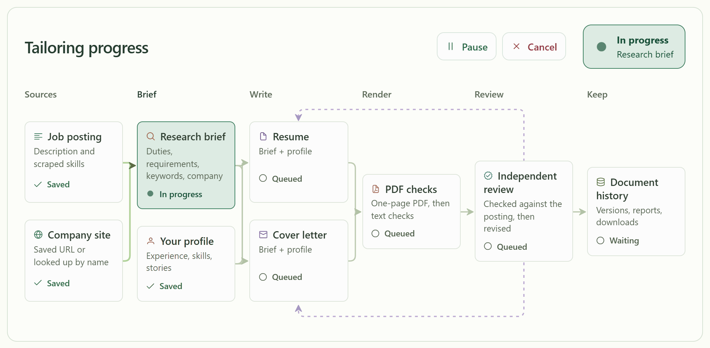

A tailoring run at about 2x speed. The companies, the student and the model's replies are all fake
here; the quote checks, the LaTeX build and the page-fit check are the real code.

## What it does

- Pulls postings from a few dozen public GitHub internship lists and 186 company job boards on 12
  platforms (Greenhouse, Lever, Ashby, Workday, ...), on a schedule or whenever you start a scrape.
- Keeps Canadian internships and co-ops, Toronto area first, and links copies of the same posting
  that show up on more than one board.
- Ranks jobs with a small embedding model that runs locally. It also picks up on which jobs you
  save and which ones you delete.
- Tracks applications with a status, notes and follow-up dates, plus an activity page.
- Writes the resume and cover letter with a research step, two writers and a reviewer, each its own
  model call. They can only use what's in your profile.
- Every job and project in your profile has a field for the stuff that didn't fit on the resume
  (tools, numbers, decisions). There are [two prompts](backend/docs/brag-sheet-prompts.md) for
  getting another AI to write that brag sheet with you; one has a coding agent read the project's
  repo and the other interviews you. The resume writer builds new bullets from it and won't claim
  anything the brag sheet lists as not done.
- Posts a daily Discord message with the new jobs and a scrape health report, if you set a webhook.

| Workspace                                          | Job calendar                               |
| -------------------------------------------------- | ------------------------------------------ |
| 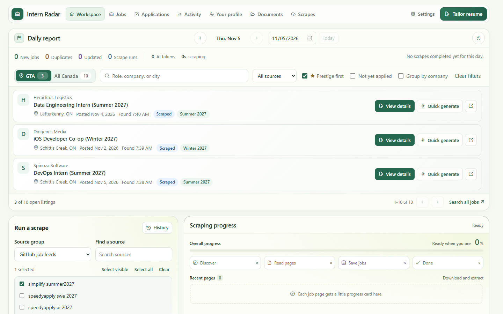       | 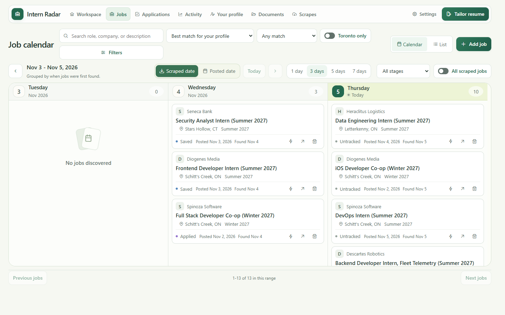 |
| **Job page**                                       | **Profile**                                |
| 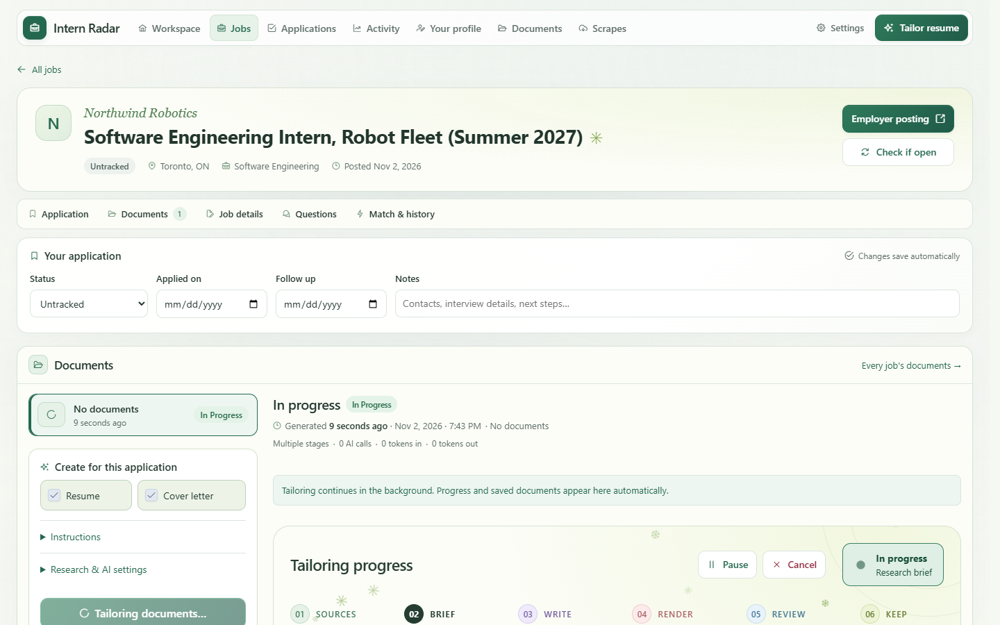       | 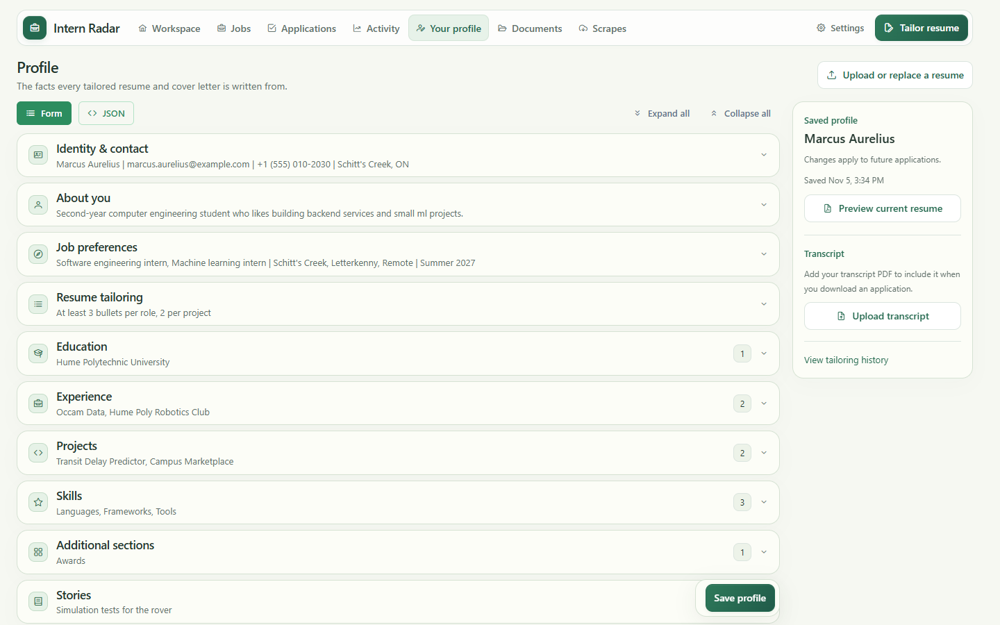   |
| **Application tracker**                            | **Activity**                               |
| 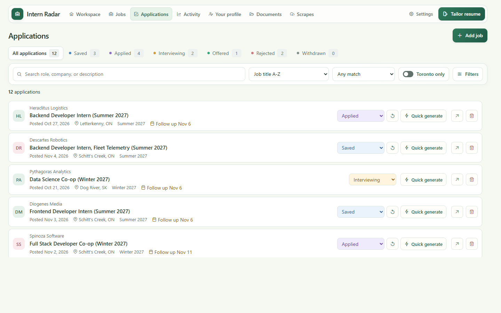 | 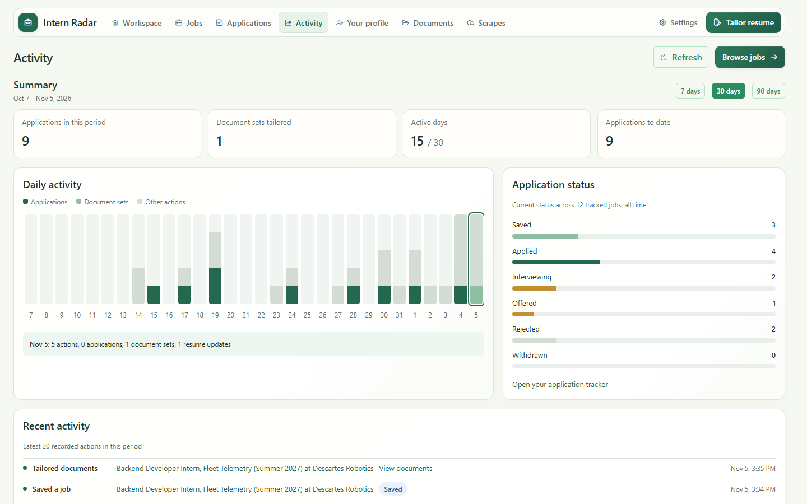 |

## Tech stack

| Part         | Built with                                                          |
| ------------ | ------------------------------------------------------------------- |
| Backend      | Python 3.11+, FastAPI, Pydantic, Playwright (headless Chromium)     |
| Storage      | PostgreSQL 18 with JSONB records                                    |
| Match scores | bge-small-en-v1.5 on ONNX Runtime, optional GPU sidecar on a Jetson |
| AI           | any OpenAI-compatible API (OpenAI, OpenRouter, Ollama, LM Studio)   |
| Documents    | LaTeX compiled with Tectonic, pypdf to read the PDF back            |
| Frontend     | Angular 21, PrimeNG, TypeScript, Vitest                             |
| Ops          | Docker Compose, nginx, GitHub Actions                               |

## How it works

The API and the scrape worker are one Python package started two different ways. Each import runs
in its own child process, and if one source crashes the rest of the batch keeps going.

The colors mean the same thing in every diagram on this page: purple is a model call, green is
plain Python, amber is you, and gray is data or something outside the app.

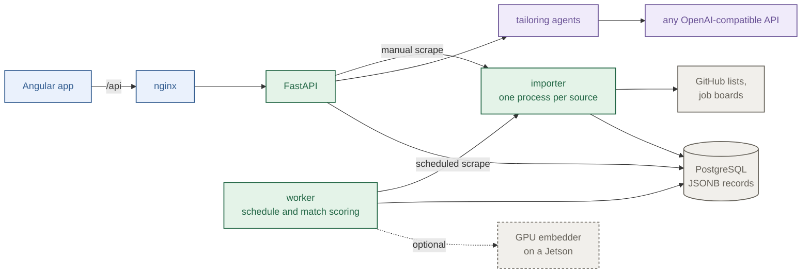

### Tailoring

Tailoring is split into a few smaller model calls with checks in between:

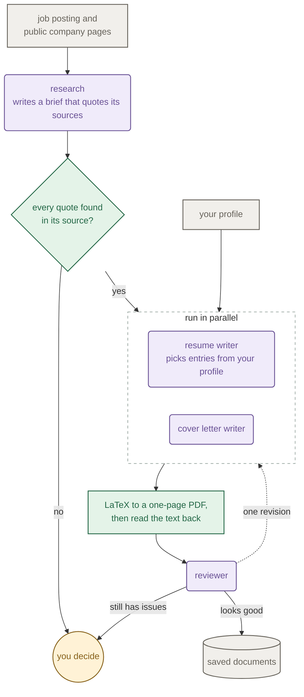

The resume writer answers in JSON and picks experience entries, bullets and skills by index from
your saved profile. There's no way for it to add a job or a skill you don't have. Before anything
gets written, the research quotes are checked against the fetched pages in Python.

### Reading a job page

Most posting pages don't need a browser at all. A job link tries the cheap options first (the page
cache, the provider's posting API, plain HTTP) and only falls back to headless Chromium when the
page comes back cut off. Pages that robots.txt rules out are never opened. Those get flagged and
you open them yourself. Every check, in order, is in
[docs/how-it-works.md](docs/how-it-works.md#reading-a-job-page).

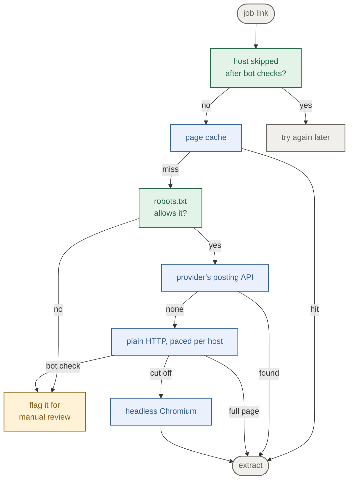

### Match scoring

Scoring uses a small embedding model that runs locally, which means no API bill per job. My first
version gave almost every job a score around 70, which isn't much of a ranking. Now the cosine
similarities get turned into percentiles across all jobs before they're weighted.

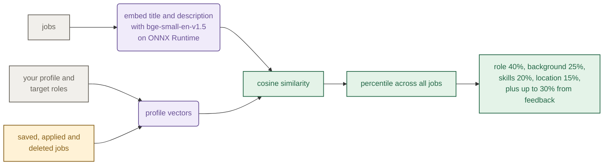

### Deployment

`docker compose up -d --build` in `backend/` starts four containers on one machine (five with the
GPU overlay). The api and the worker run the same image. They don't talk to each other directly;
both go through Postgres, and a lock file on the shared volume stops two scrape batches from
running at once. Each diagram links to its notes in
[docs/how-it-works.md](docs/how-it-works.md#deployment).

| Docker services                                                                          | Inside the api and worker                                                                                    |
| ---------------------------------------------------------------------------------------- | ------------------------------------------------------------------------------------------------------------ |
| [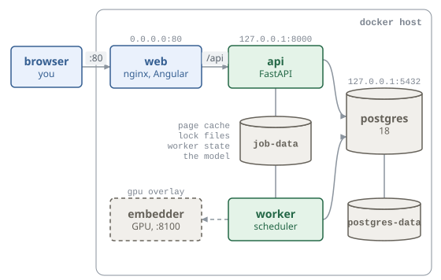](docs/how-it-works.md#docker-services) | [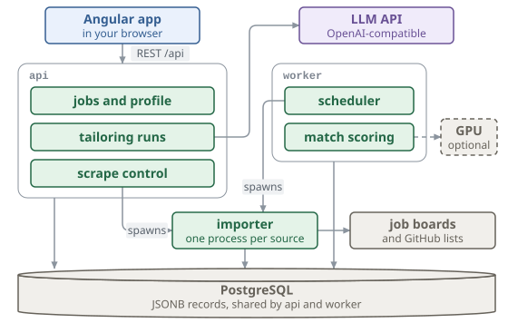](docs/how-it-works.md#inside-the-api-and-worker) |
| **Starting up**                                                                          | **The worker loop**                                                                                          |
| [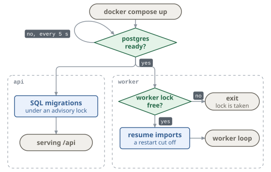](docs/how-it-works.md#starting-up)            | [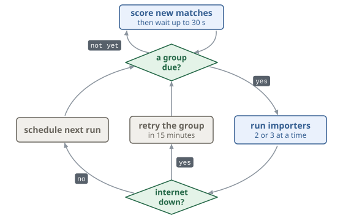](docs/how-it-works.md#the-worker-loop)                    |

The rest of [docs/how-it-works.md](docs/how-it-works.md) covers the
[states a tailoring run goes through](docs/how-it-works.md#tailoring), what each scrape does, and
the data model.

## Running it

You need Docker. Tailoring also needs an OpenAI-compatible endpoint (OpenAI, OpenRouter, or a local
Ollama or LM Studio server).

```sh
cd backend
cp .env.example .env     # set JOB_POSTGRES_PASSWORD, and the JOB_AI_ lines for tailoring
docker compose up -d --build
```

Open http://localhost, fill in your profile (or upload a resume) and run a scrape from the
workspace. After that the worker scrapes by itself. GitHub lists get checked every 2 hours, job
board APIs every 3, and the bigger career sites at 03:00 and 15:00
([schedules.json](backend/src/job_backend/scrape/worker/schedules.json)).

If other machines can reach the server, set a sign-in password first. Run
`python -m job_backend.auth.hash_password` and paste the printed line into `backend/.env`.

### GPU embeddings (optional)

Match scoring runs on the CPU by default. I run mine on an NVIDIA Jetson, and with JetPack 6 and the
nvidia container runtime the embedding model can use its GPU:

```sh
docker compose -f compose.yaml -f compose.gpu.yaml up -d --build
```

If the GPU sidecar goes down, the worker just keeps scoring on the CPU.

### Local development

Backend, Python 3.11 or newer:

```sh
cd backend
python -m venv .venv
source .venv/bin/activate      # windows: .venv\Scripts\activate
python -m pip install -e '.[dev]'
cp .env.example .env
docker compose up -d postgres
python -m uvicorn job_backend.main:app --reload    # api docs at http://localhost:8000/docs
python -m job_backend.scrape.worker                # the scheduler, in another terminal
```

Frontend, Node 24:

```sh
cd frontend
npm ci
npm start    # http://localhost:4200, /api is proxied to localhost:8000
```

PDF export needs [Tectonic](https://tectonic-typesetting.github.io/). To scrape a single source by
hand, use `python -m job_backend.cli --repo simplify-summer2027` or `--company 1password`
(`--list-companies` prints every board).

`python scripts/check.py` runs what CI runs: ruff, pyright, pytest, eslint, prettier, the
production build and the frontend tests. The tests run offline and never call a paid API. If you
send a PR, please run it first, and keep new scrapers to public sources - no logins and no getting
around bot checks.

## Known limitations

- It's built around Canadian internships, Toronto first. Other countries would need new location
  rules.
- Single user: one profile, an optional password, no accounts.
- Postings that only exist on LinkedIn, Indeed or Glassdoor get missed. That's on purpose (see
  [why](docs/how-it-works.md#why-its-built-this-way)).
- When robots.txt rules out a posting's page, you get a flag to open it yourself and only the
  details the list had.
- Without AI, extraction is rule-based and sometimes gets odd postings wrong. AI extraction for
  scrapes is opt-in.
- Tailoring makes paid API calls. The app shows token counts, but please read what it writes
  before you send it anywhere.
- The GPU overlay mounts the Jetson's CUDA and cuDNN libraries from the host and won't work as-is
  on other GPUs.

## Layout

```text
backend/src/job_backend/
  scrape/        github lists, job board adapters, import pipeline, scheduler
  jobs/          saved jobs, browsing, tailoring runs
  resumes/       research, writers, reviewer, latex, pdf checks
  matching/      embedding-based match scores
  profile/       your profile
  persistence/   postgres access and migrations
backend/embedder/  optional gpu embedding sidecar
frontend/src/app/  angular app
```

## License

[MIT](LICENSE). Resumes use
[Jake's resume template](backend/src/job_backend/resumes/render_latex/templates/JAKE_TEMPLATE_LICENSE.txt),
also MIT.
