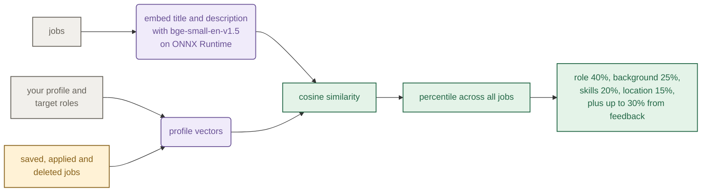

# Intern Radar

Intern Radar pulls new Canadian internship postings from public GitHub lists and 186 company job
boards every few hours, ranks them against your profile, tracks your applications, and writes a
tailored one page resume and cover letter for a posting with a few separate AI agents.


A tailoring run, sped up about 2x. Everything in the GIF and screenshots is made-up demo data
(fake companies, a fake student), and the model's replies in the GIF are scripted. The rest is the
real pipeline: quote checks, LaTeX, the one page check and the reviewer.

## What it does

- **Collects postings** from a few dozen public GitHub internship lists and 186 company job boards
  on 12 platforms (Greenhouse, Lever, Ashby, Workday...), on a schedule or when you start a scrape.
- **Filters and dedupes.** It keeps Canadian internships and co-ops, puts the Toronto area first,
  and links copies of the same posting found on several boards.
- **Ranks by fit** with a small local embedding model that also learns from the jobs you save and
  delete.
- **Tracks applications** with a status, notes, follow up dates and an activity page.
- **Tailors documents.** A research step, two writers and a reviewer produce a one page resume and
  a cover letter that only use what's in your profile.
- **Uses the context your resume leaves out.** Every job and project in your profile has a field
  for the details that didn't fit: tools, numbers, decisions. Another AI can write that brag
  sheet for you with [two prompts](backend/docs/brag-sheet-prompts.md): one has a coding agent
  read the project's repository, the other interviews you. The resume writer builds new bullets
  from it and never claims anything the brag sheet lists as not done.
- **Posts to Discord** if you want: a daily message with the new jobs and a scrape health report.

| Workspace                                          | Job calendar                               |
| -------------------------------------------------- | ------------------------------------------ |
|        |  |
| **Job page**                                       | **Your profile**                           |
|        |    |
| **Application tracker**                            | **Activity**                               |
|  |  |

## Tech stack

| Part         | Built with                                                              |
| ------------ | ----------------------------------------------------------------------- |
| Backend      | Python 3.11+, FastAPI, Pydantic, Playwright (headless Chromium)         |
| Storage      | PostgreSQL 18 with JSONB records                                        |
| Match scores | bge-small-en-v1.5 on ONNX Runtime, optional GPU sidecar on a Jetson     |
| AI           | any OpenAI compatible API (OpenAI, OpenRouter, Ollama, LM Studio)       |
| Documents    | LaTeX compiled with Tectonic, pypdf to read the PDF back                |
| Frontend     | Angular 21, PrimeNG, TypeScript, Vitest                                 |
| Ops          | Docker Compose, nginx, GitHub Actions                                   |

## How it works

The API and the scrape worker are the same Python package started two ways. Every import runs as
its own child process, so one broken source can't take a whole batch down with it.


### Tailoring

Tailoring is a chain of separate model calls instead of one big prompt. Purple rounded boxes are
model calls. Green boxes are checks in plain Python, not another model call:


The resume writer returns JSON, not prose. It picks experience entries, bullets and skills by index
from the saved profile, so it can't add a job or a skill you don't have. The research quotes are
checked against the fetched pages in plain Python, not by asking the model again.

### Reading a job page

Most posting pages don't need a browser. Each job link tries the cheapest way to read the page
first, and headless Chromium is the last resort. A page the site's robots.txt rules out is never
opened. Blue boxes fetch the page, and amber means you open it yourself.
[docs/how-it-works.md](docs/how-it-works.md#reading-a-job-page) has every check in order:


### Match scoring

Jobs are ranked by a small embedding model that runs locally, so scoring costs nothing per job. Raw
similarity rates almost every job as a decent match, so scores become percentiles first. Same colors
as above: purple is the model, green is plain Python and amber is you:



### Deployment

`docker compose up -d --build` in `backend/` starts four containers on one machine, five with the
GPU overlay. The api and the worker run the same image and never call each other: they share
Postgres, and lock files on the data volume let only one scrape batch run at a time. Same colors
as above. Click a diagram for its notes in
[docs/how-it-works.md](docs/how-it-works.md#deployment):

| Containers                                                                     | Components                                                                                |
| ------------------------------------------------------------------------------ | ----------------------------------------------------------------------------------------- |
| [](docs/how-it-works.md#containers) | [](docs/how-it-works.md#components)            |
| **Starting up**                                                                | **The worker loop**                                                                       |
| [](docs/how-it-works.md#starting-up)  | [](docs/how-it-works.md#the-worker-loop) |

[docs/how-it-works.md](docs/how-it-works.md) has the rest: the
[states a tailoring run moves through](docs/how-it-works.md#tailoring), what each scrape does and
the data model.

## Running it

You need Docker. Tailoring also needs an OpenAI compatible endpoint (OpenAI, OpenRouter, or a local
Ollama or LM Studio server).

```sh
cd backend
cp .env.example .env     # set JOB_POSTGRES_PASSWORD, and the JOB_AI_ lines for tailoring
docker compose up -d --build
```

Open http://localhost, fill in your profile (or upload a resume) and run a scrape from the
workspace. The worker also scrapes on its own: GitHub lists every 2 hours, job board APIs every 3
hours and career sites at 03:00 and 15:00 ([schedules.json](backend/src/job_backend/scrape/worker/schedules.json)).

If other machines can reach the server, set a sign in password first. Run
`python -m job_backend.auth.hash_password` and paste the printed line into `backend/.env`.

### GPU embeddings (optional)

Match scoring runs on the CPU by default. On an NVIDIA Jetson with JetPack 6 and the nvidia
container runtime, the embedding model can run on the GPU instead:

```sh
docker compose -f compose.yaml -f compose.gpu.yaml up -d --build
```

If the GPU sidecar goes down, the worker keeps scoring on the CPU.

### Local development

Backend, Python 3.11 or newer:

```sh
cd backend
python -m venv .venv
source .venv/bin/activate      # windows: .venv\Scripts\activate
python -m pip install -e '.[dev]'
cp .env.example .env
docker compose up -d postgres
python -m uvicorn job_backend.main:app --reload    # api docs at http://localhost:8000/docs
python -m job_backend.scrape.worker                # the scheduler, in another terminal
```

Frontend, Node 24:

```sh
cd frontend
npm ci
npm start    # http://localhost:4200, /api is proxied to localhost:8000
```

PDF export needs [Tectonic](https://tectonic-typesetting.github.io/). You can also scrape a single
source by hand with `python -m job_backend.cli --repo simplify-summer2027` or
`--company 1password`, and `--list-companies` prints every board.

`python scripts/check.py` runs what CI runs: ruff, pyright, pytest, eslint, prettier, the
production build and the frontend tests. The tests run offline and never call a paid API.

## Known limitations

- It's built for Canadian internships, Toronto area first. Other countries would
  need new location rules.
- One user. There's a single profile and an optional password, no accounts.
- Postings that only exist on LinkedIn, Indeed or Glassdoor are missed on purpose.
- A posting whose page is ruled out by the site's robots.txt is flagged for you to open, with only
  the details its list gave.
- Without AI, extraction is rule based and can get unusual postings wrong. AI extraction for
  scrapes is opt in.
- Tailoring makes paid API calls. The app shows the token counts, but read everything it writes
  before you send it.
- The GPU overlay is written for a Jetson. It mounts the host's CUDA and cuDNN libraries, so other
  GPUs need a different compose file.

## Layout

```text
backend/src/job_backend/
  scrape/        github lists, job board adapters, import pipeline, scheduler
  jobs/          saved jobs, browsing, tailoring runs
  resumes/       research, writers, reviewer, latex, pdf checks
  matching/      embedding based match scores
  profile/       your profile
  persistence/   postgres access and migrations
backend/embedder/  optional gpu embedding sidecar
frontend/src/app/  angular app
```

## License

[MIT](LICENSE). Resumes use
[Jake's resume template](backend/src/job_backend/resumes/render_latex/templates/JAKE_TEMPLATE_LICENSE.txt),
also MIT.
