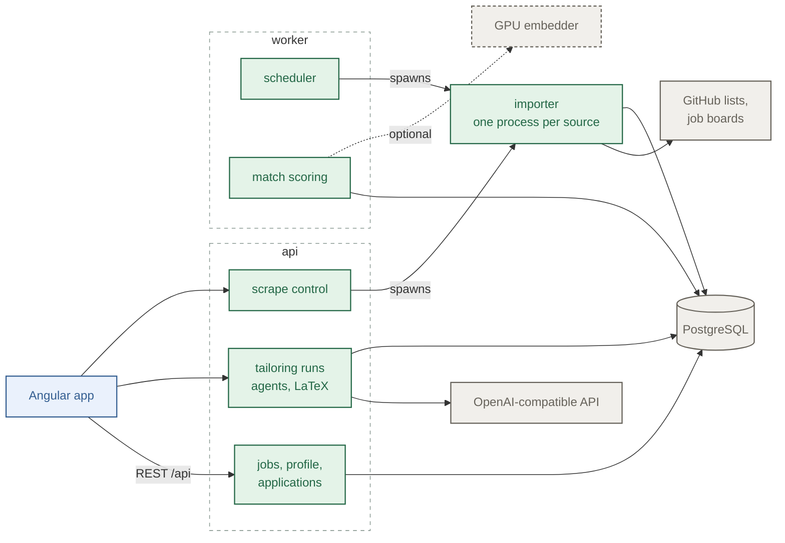
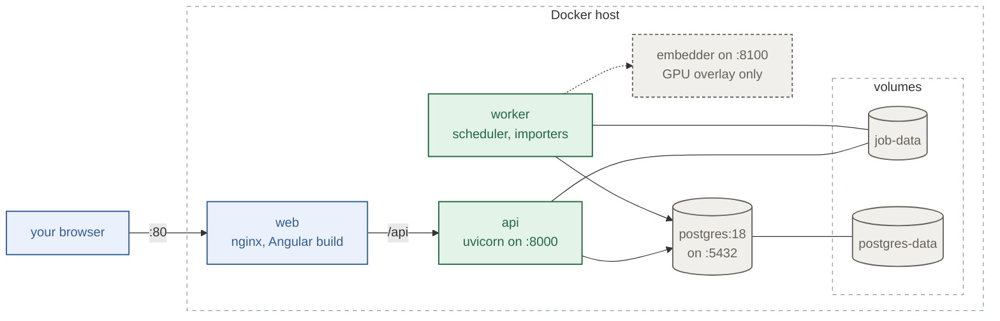
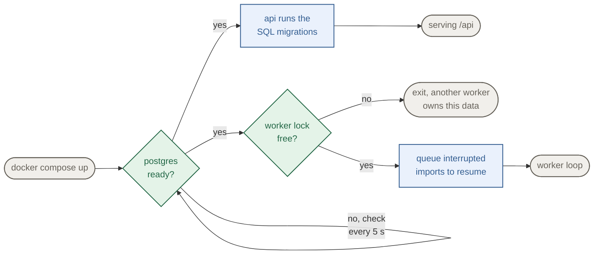
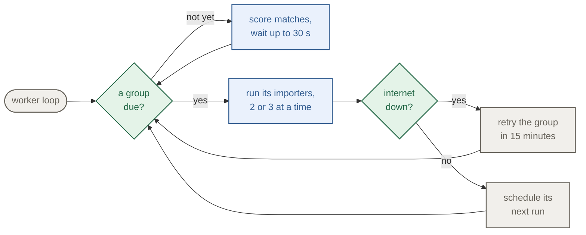
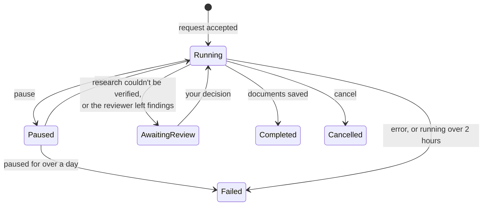
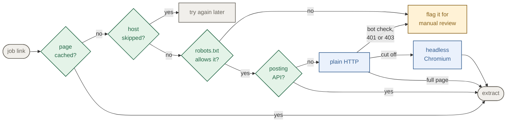
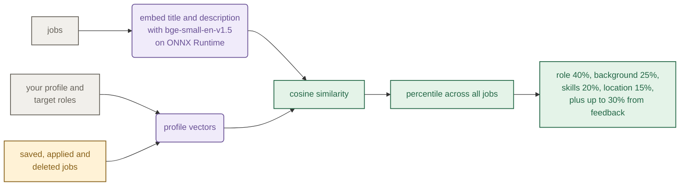

# How it works

Notes on the parts that aren't obvious from the code. The README has the overview and setup.

## Processes

| Process  | What it does                                                                         |
| -------- | ------------------------------------------------------------------------------------ |
| api      | FastAPI app. Serves the frontend's `/api` calls and runs tailoring in the background |
| worker   | runs scrapes on the schedule, posts the Discord reports, scores matches when idle    |
| importer | `python -m job_backend.cli`, one child process per source, started by either one     |
| web      | nginx with the built Angular app, passes `/api` to the api                           |
| embedder | optional GPU sidecar for match scoring (`compose.gpu.yaml`)                          |

The api and worker are the same Python package and the same Docker image.

## Deployment

Everything runs on one machine with Docker Compose. `docker compose up -d --build` in `backend/`
builds two images and starts four containers. The GPU embedder is a fifth one, added by
`compose.gpu.yaml`.

### Inside the api and worker

The api and the worker never call each other. They share PostgreSQL, and lock files on the data
volume make sure only one scrape batch runs at a time, whether the schedule or you started it.



### Docker services

The api and worker run the same image, with Python, headless Chromium and Tectonic in it. Only
`web` is published on every interface. The api and Postgres are only published on 127.0.0.1, so
other machines can only reach the app through nginx.



| Volume          | What's in it                                                      |
| --------------- | ----------------------------------------------------------------- |
| `job-data`      | the page cache, worker state, lock files and the downloaded model |
| `postgres-data` | the database                                                      |

### Starting up

Compose starts the api and the worker once Postgres passes its health check, and `web` once the
api container is up. Migrations take a Postgres advisory lock, which stops two processes that
start at the same moment from both applying them. If the api can't reach Postgres it stays up,
answers 503 and tries again every 5 seconds.



A scheduled import that a restart cut off picks up where it stopped. Sources that finished before
the restart are skipped.

### The worker loop



While nothing is due, the worker scores new matches and, once a day, posts the health report to
Discord if a webhook is set. When not a single source in a batch could be reached, the worker
treats the internet as down and retries the group in 15 minutes rather than waiting for its next
slot. The groups and their times are in [Scraping](#scraping).

## Tailoring

Clicking "Research and tailor" sends a request id that the browser makes up. The api saves the
attempt under that id and answers right away. A double click or a retried request gets back the
run that already exists, and you don't pay for a second one. The work runs as a background task and
the page polls `GET /documents/{id}`, which returns the stages, events and the model's streamed
output. Everything is saved, so you can close the tab and come back.



The steps:

1. **Research** reads the posting and a few public pages about the company and writes a brief:
   duties, requirements, keywords and company context. Every claim has to quote its source and
   the quotes are checked against the fetched text. If they don't check out, the run waits for
   you to approve, edit, or ask for a generic report.
2. **Writers** run at the same time. The resume writer picks entries and bullets by index from your
   profile and says which original bullet or saved detail each line came from. Skills come from
   your saved skill lists and it can't add one you don't have.
3. **Render and checks.** Drafts go through a LaTeX template and Tectonic. Long bullets get
   shortened until the resume fits on one page, then the text is read back out of the PDF to check
   what an applicant tracking system will see (contact info, dates, headings, skills).
4. **Review.** A separate reviewer reads the posting, the brief and both drafts and can ask for one
   revision. Anything still open waits for you.

There's also a one-shot mode that does everything in a single call and keeps the same checks.
Pausing takes effect between steps, and cancelling keeps every report and finished document.

## Scraping

| Group             | Sources                                                                               | When            |
| ----------------- | ------------------------------------------------------------------------------------- | --------------- |
| GitHub lists      | Simplify, SpeedyApply, Jobright and other public internship lists                     | every 2 hours   |
| Public board APIs | Greenhouse, Lever, Ashby, Workable, SmartRecruiters, Recruitee, HiBob, EmploymentHero | every 3 hours   |
| Career site APIs  | Workday, Oracle Recruiting Cloud, SuccessFactors, Avature                             | 03:00 and 15:00 |

When a group is due, the worker takes the import lock and starts one importer process per source,
a few at a time, preferring sources on different hosts. Each importer:

1. fetches the listing with the ETag from last time, so an unchanged list costs a 304
2. drops records that aren't Canadian student roles
3. reads the job pages it still needs (see below)
4. extracts title, company, location, terms and requirements, with rules by default or with AI
   if you turn it on for that scrape
5. saves the jobs, links duplicates across boards, and closes postings that left a board after
   two complete listings in a row didn't have them

Sources that failed on a network error get one more try 30 seconds after the batch. A source that
runs past its time limit gets its whole process group killed.

### Reading a job page



- Pages stay in a SQLite cache for 1 to 7 days, picked at random so re-reads spread out.
- Every page, redirect and browser visit is checked against the site's robots.txt first
  ([RFC 9309](https://www.rfc-editor.org/rfc/rfc9309)). A page it rules out is never opened;
  the job is flagged for you to open, like a LinkedIn posting. Board feeds and published job
  board APIs skip this check because they're put out for programs to read.
- Every request sends `intern-radar-importer/0.1 (+https://github.com/KelvinWCH/intern-radar)`
  as its user agent. The browser keeps its own and adds that to the end.
- Every import, manual or scheduled, waits 2 to 5 seconds between requests to the same host,
  honours `Retry-After`, and stops asking a host for the rest of the run after a 401 or 403.
- A host that keeps showing bot checks is skipped for a day, then three days, then a week.
- Every URL, redirects included, has to resolve to a public IP address before it's requested, so
  a job link can't point the scraper at something on the local network.

### Adding a source

A company board is one entry in
[`companies.json`](../backend/src/job_backend/scrape/companies/companies.json):

```json
{
  "key": "acme",
  "name": "Acme",
  "careers_url": "https://job-boards.greenhouse.io/acme",
  "job_board": "greenhouse",
  "board_name": "acme"
}
```

A new GitHub list is a copy of one of the files in `scrape/github/github_sources/`, registered in
`scrape/github/github.py`. A new platform is a `JobSource` with a `fetch(etag)` and a
`scrape(payload)` function, like the adapters in `scrape/greenhouse/` or `scrape/lever/`.

## Data

Every record is a typed Python dataclass stored as JSONB in one PostgreSQL table keyed by
`(collection, key)`. The main collections:

| Collection                      | What's in it                                                     |
| ------------------------------- | ---------------------------------------------------------------- |
| `jobs`                          | one posting: company, title, locations, description, open/closed |
| `job_user_data`                 | your status, notes and dates for a job, with a version number    |
| `job_documents`                 | one tailoring attempt: stages, research, drafts, review, PDFs    |
| `user_profile`                  | your profile, with a revision number                             |
| `import_runs`, `scrape_events`  | one run per source per batch, and its log lines                  |
| `job_embeddings`, `job_matches` | vectors and the latest match score with its reasons              |

Edits use optimistic locking. A save with an old version number gets rejected and the newer copy
stays. Lists don't read the full records. A trigger keeps a small projection
table with just the fields list pages filter and sort on, plus normalized search text. The SQL
migrations in `persistence/sql/` run on startup and are checksummed, so an edited migration
refuses to start.

## Match scoring



Raw similarity rated almost every job as a decent match (everything sat around 70), which is why
scores are turned into percentiles across all saved jobs first. Non-internships, roles you're not eligible for and postings far from
every target role get pushed down. The worker only scores while it's idle. With the GPU sidecar it
sends batches to `JOB_EMBEDDER_URL`, and if the sidecar doesn't answer it falls back to the CPU
and checks the sidecar again 10 minutes later.

## Why it's built this way

**Only public sources.** The big job sites forbid scraping and block it, and getting around that
means faking browsers or solving CAPTCHAs. I didn't want to do either. Some postings get missed
because of it, mostly ones that only exist on those sites.

**JSONB records instead of a table per type.** Postings come from a dozen providers and the record
shapes kept changing. Adding a field is a code change with no migration. The downside is that
validation lives in Python and the database can't stop a bad write by itself.

**One process per source.** A crash, a memory leak or a stuck browser only costs one source.
Scheduled, manual and command-line imports also share one code path this way.

**HTTP before a browser.** Most posting pages already have the whole description in the HTML or
in JSON-LD. Skipping the browser keeps imports fast and light enough for a small server. When the
browser does run, it keeps its sandbox on and goes through the same public address check.

**Separate agents, with checks in code.** A writer that can only pick from the profile plus a
separate reviewer catches a lot more made-up claims than one prompt checking itself. It costs
more calls, which is what the one-shot mode is for.

**Validate everything that comes in.** Scraped pages, provider APIs, model output and the browser
can all send back something unexpected. The backend runs anything crossing a boundary through
Pydantic, and the frontend parses every API response before a component sees it. Bad data fails
early with a clear error.
